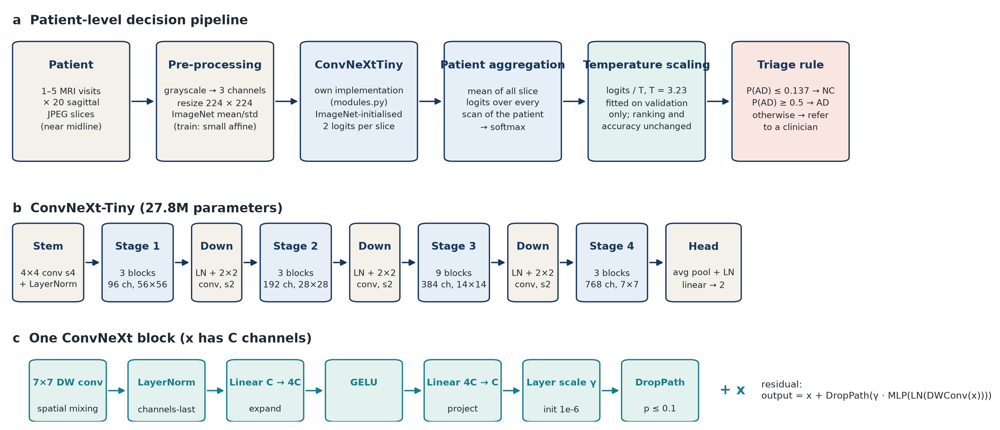
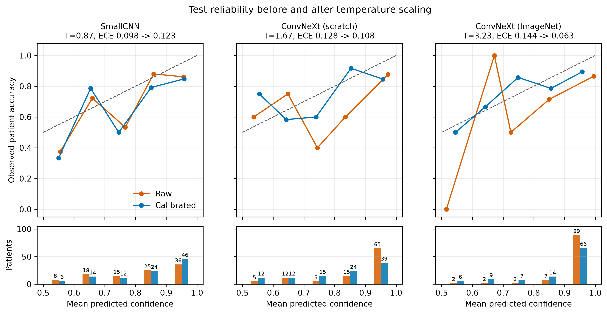
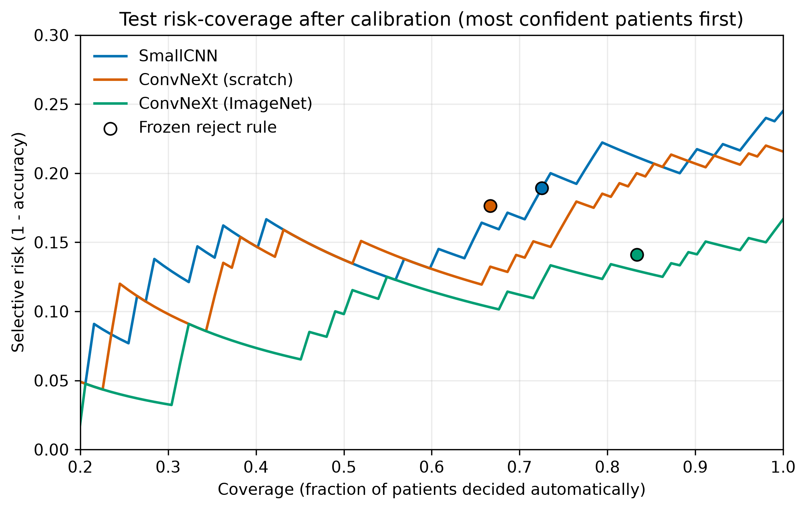

# Patient-Level Alzheimer’s Disease Classification from ADNI MRI with ConvNeXt

**Student:** s4985908  
**Course:** COMP3710 Pattern Recognition  
**Project:** ADNI AD-versus-CN classification — Hard difficulty

## Executive summary

This project develops a patient-level classifier for distinguishing Alzheimer’s disease (AD) from cognitively normal controls (CN) using preprocessed sagittal MRI slices from ADNI. Every slice of every visit is passed through the project’s own ConvNeXt-Tiny implementation, initialised from ImageNet weights and fine-tuned on ADNI. The slice logits are averaged into one decision per patient. A validation-fitted temperature then calibrates the patient probability, and a triage rule either decides the case or refers it to a clinician. A compact SmallCNN and a randomly initialised ConvNeXt-Tiny serve as baselines on the identical patient split.



The final model correctly classified **85 of 102 held-out patients (83.33% accuracy; unadjusted 95% CI 74.9–89.3%)**, meeting the 0.80 target as a point estimate, with **0.7931 macro-F1** and **0.8546 AUROC**. Because earlier test results were seen before this model was developed, its test results are exploratory and may carry selection bias of unknown size (Section 7). With that caveat, an unadjusted paired bootstrap favours its AUROC over both baselines, while its accuracy advantage over the scratch ConvNeXt is not significant (McNemar p = 0.30).

On the engineering dilemma, the larger model was **more** overconfident than the baseline before calibration. It assigned confidence of at least 0.9 to 89 of the 102 test patients, and 12 of its 17 errors were made at that level. Temperature scaling (T = 3.23) reduced test ECE from 0.144 to 0.063, the best of the three models. However, no model’s confidence separated its correct from incorrect decisions well (AUROC 0.67–0.70 for all three). The validation-fitted reject option decided 83% of patients automatically at 85.9% accuracy, but it still cleared 8 of the 33 AD patients as normal without review, more than either baseline. The recommendation is therefore to adopt the ImageNet ConvNeXt for research and clinician-facing decision support, but **not** to let it clear patients autonomously.


## 1. Problem and research questions

ADNI provides multiple MRI scans per patient and 20 two-dimensional slices per scan. This creates two important engineering challenges:

1. slices and repeated visits from the same patient are correlated, so a slice-level random split would leak identity information;
2. a high aggregate accuracy can conceal overconfident or clinically costly errors.

The project therefore asks:

- Does ConvNeXt-Tiny improve patient-level performance over SmallCNN, and are the gains statistically meaningful on 102 test patients?
- Does ImageNet initialisation improve ConvNeXt optimisation and generalisation?
- Does ConvNeXt quantify uncertainty better than the baseline: are its probabilities calibrated, and does its confidence separate correct from incorrect decisions?
- Can a validation-selected reject option safely automate confident cases and route ambiguous patients to human review?
- Is the performance improvement justified by the additional compute cost?

In the source code, the normal class is named `NC`; it is equivalent to CN in this report.

## 2. Feasibility review

This is the written feasibility review presented during the compulsory tutor check-off. The tutor confirmed that the scope, patient-level split, model comparison, and proposed evaluation were appropriate.

### User need, scope, and acceptance criteria

The intended user is a research team investigating an MRI-based screening assistant. The prototype returns one AD/CN prediction and calibrated confidence per patient, with an optional referral decision. It is not intended to replace a clinician.

| Acceptance criterion | Target | Final outcome |
|---|---:|---:|
| Patient leakage | zero subject overlap | achieved |
| Held-out patient accuracy | at least 0.80 | **0.8333** |
| Evaluation | accuracy, class metrics, macro-F1, AUROC, calibration | achieved |
| GPU feasibility | peak training VRAM below 6 GB | **4.12 GB** |
| Ambiguity handling | validation-only calibration and referral thresholds | achieved |

### Model choice and course concepts

The project uses a hard-difficulty ConvNeXt-Tiny classifier. ConvNeXt modernises convolutional networks with a patchifying stem, depthwise convolutions, LayerNorm, inverted bottlenecks, GELU activations, residual connections, stochastic depth, and layer scale. These elements connect directly to course concepts including convolutional feature extraction, normalisation, regularisation, transfer learning, class imbalance, calibration, and rigorous held-out evaluation. SmallCNN provides a transparent baseline, while the scratch and ImageNet-initialised ConvNeXt runs separate architecture capacity from transfer-learning effects.

### Preliminary feasibility evidence

The data audit found 30,520 valid JPEG slices, 1,526 scans, and 680 patients, with exactly 20 slices per scan. It also found 216 patients shared between the supplied directory-level train and test sets. This made a new patient-level split necessary. CPU and GPU smoke tests confirmed valid `(N, 3, 224, 224)` batches, two-class logits, finite gradients, checkpoint saving, and full patient aggregation. ConvNeXt used approximately 4.12 GB peak training VRAM on an A100, within the resource budget.

### Risks, compute budget, and fallback

The main risks were patient leakage, class imbalance, overfitting of a 27.8M-parameter model, validation overfitting during calibration, and long GPU queue times. The planned budget was one A100 GPU, batch size 64, and at most 30 epochs per main experiment. The fallback was the 0.39M-parameter SmallCNN, which had already completed end-to-end training and inference. Additional safeguards included a deterministic split, patient-aware balanced sampling, validation-only checkpoint selection, explicit test locking, automated tests, and preservation of every experiment log.

## 3. Data audit and patient-level split

The course dataset is located at:

```text
/home/groups/comp3710/ADNI
```

JPEG filenames encode a scan identifier and slice index. `meta_data_with_label.json` maps each scan to a subject and diagnosis. Metadata label 2 is mapped to AD (model target 1), and label 0 is mapped to NC (model target 0).

The supplied directories had no repeated scan IDs, but **216 patients occurred in both directories**. Reusing that split would allow scans from one person to influence both training and evaluation. `scripts/audit_data.py` therefore pools the scans and calls `stratified_subject_split()` in `dataset.py`, which performs a deterministic, diagnosis-stratified 70/15/15 patient split using seed 3710. Every slice, scan, and visit from one subject remains in exactly one split.

| Split | Patients | AD | NC | Scans | Slices |
|---|---:|---:|---:|---:|---:|
| Train | 476 | 155 | 321 | 1,081 | 21,620 |
| Validation | 102 | 33 | 69 | 228 | 4,560 |
| Test | 102 | 33 | 69 | 217 | 4,340 |
| **Total** | **680** | **221** | **459** | **1,526** | **30,520** |

The resulting subject overlap is zero. Validation is used for checkpoint selection, temperature fitting, and reject-threshold selection. The test split was never used to choose checkpoints, temperatures, or thresholds; Section 7 records every time it was evaluated. Generated manifests contain machine-specific paths and are excluded from Git.

## 4. Preprocessing and patient aggregation

**Example input.** One patient is one to five MRI visits, each contributing 20 consecutive skull-stripped sagittal grayscale JPEG slices. In every scan these slices cover a 19-slice window between original indices 78 and 114, centred on the midline. The montages show the corpus callosum, lateral ventricles, brainstem, cerebellum and medial cortex. Because the window is narrow and centred on the midline, lateral structures such as the hippocampi are probably only partly represented; this is inferred from the slice indices and the montages and was not checked against an anatomical atlas. MRI slices are not reproduced in this repository because they are course medical data; Figure 1 shows the input format schematically.

`dataset.py` validates the manifest and rejects any patient overlap. Each grayscale slice is resized to 224 × 224, copied into three channels, converted to a tensor, and normalised with ImageNet channel statistics. Training applies conservative random affine augmentation (±5° rotation, 2% translation, 0.95–1.05 scale); validation and test transforms are deterministic.

Training is slice-based for computational efficiency. A patient-and-class-aware weighted sampler prevents the larger NC class and patients with many visits from dominating updates. During evaluation, the model processes all slices and all scans in the selected split. For patient `p`, logits are aggregated before softmax:

```text
patient_logit(p) = mean(logit(slice) for every slice from patient p)
patient_probability(p) = softmax(patient_logit(p))
```

All headline metrics are therefore patient-level. No patient’s 20 slices are divided between training, validation, and test.

## 5. Models

### 5.1 SmallCNN baseline

SmallCNN stacks four blocks of 3 × 3 convolution, BatchNorm, ReLU, and 2 × 2 max pooling (32, 64, 128 and 256 channels), followed by global average pooling, dropout, and a two-class linear head. Each 3 × 3 convolution only sees a small neighbourhood, so large anatomical patterns must be assembled through repeated pooling. It contains **389,410 trainable parameters** and supplies a low-cost reference for the complete pipeline.

### 5.2 ConvNeXt-Tiny: working principles

`ConvNeXtTiny` in `modules.py` implements the architecture of Liu et al. [1], which redesigns a ResNet using choices borrowed from vision transformers (Figure 1b–c).

- **Patchify stem.** A 4 × 4 convolution with stride 4 turns the 224 × 224 slice into a 56 × 56 grid of 96-channel patch embeddings, followed by LayerNorm.
- **Four stages.** Stage depths are `[3, 3, 9, 3]` with `[96, 192, 384, 768]` channels at 56, 28, 14 and 7 pixels resolution. Between stages, LayerNorm and a 2 × 2 stride-2 convolution halve the resolution and double the channels.
- **ConvNeXt block.** Each block computes

```text
y = x + DropPath( γ * W2 · GELU( W1 · LayerNorm( DWConv7x7(x) ) ) )      (* = per-channel scaling)
```

  The 7 × 7 depthwise convolution mixes information spatially, one channel at a time, which gives a large receptive field cheaply, similar to a local attention window. LayerNorm and the two pointwise linear layers (`W1`: C → 4C, `W2`: 4C → C) form an inverted bottleneck that mixes channels. The learnable per-channel layer scale `γ` starts at 1e-6, so every block begins close to the identity and the 18-block network trains stably. Stochastic depth (DropPath) randomly skips whole residual branches during training, with a rate rising linearly from 0 to 0.1 across the blocks, which regularises the deep model.
- **Head.** Global average pooling, LayerNorm, dropout 0.3, and a linear layer produce the NC/AD logits.

The model contains **27,821,666 trainable parameters**, about 71 times more than SmallCNN. Section 5.3 explains how the same class is initialised from ImageNet.

### 5.3 Final ImageNet-initialised ConvNeXt-Tiny

The final model is the same `ConvNeXtTiny` class from `modules.py` described in Section 5.2; only its starting weights differ. `load_imagenet_weights()` downloads torchvision’s `ConvNeXt_Tiny_Weights.IMAGENET1K_V1`, renames every tensor to this project’s layer names with `convert_torchvision_convnext_state_dict()`, discards the 1,000-class ImageNet head, and keeps a freshly initialised two-class head. Loading is strict: every one of the 180 backbone tensors must match, otherwise training stops. The whole network is then fine-tuned on ADNI, so the architecture and parameter count (27,821,666) are identical to the scratch model.

The first ImageNet run (job 650741) was trained with torchvision’s own ConvNeXt class. Because both implementations have identical layers, its frozen checkpoint was converted into `ConvNeXtTiny` and re-evaluated without retraining. Two unit tests check the conversion. One confirms that every backbone tensor is mapped; the other confirms that a randomly weighted torchvision model and the converted `ConvNeXtTiny` produce the same logits within floating-point tolerance (`rtol = 1e-4`, `atol = 1e-5`). For the real checkpoint, `scripts/compare_predictions.py` found the stored patient logits of all 102 validation and all 102 test patients to be exactly equal to those of the original run, with no change in any predicted class, and all 129 numeric entries of the final `evaluation.json` were exactly equal. These comparison summaries are committed as `figures/report/checkpoint_equivalence_validation.json` and `checkpoint_equivalence_test.json`. All results reported for the final model therefore come from this project’s own ConvNeXt implementation.

ImageNet initialisation provides reusable low-level edge, texture, and shape filters, which makes optimisation more data-efficient than learning all 27.8M parameters from scratch. The pretrained weights are third-party material and are acknowledged in the references.

## 6. Training and model selection

All three models use the same patient split, transforms, balanced sampler, patient aggregation, seed 3710, AdamW optimiser, cosine learning-rate decay, weight decay `1e-4`, dropout `0.30`, batch size 64, and mixed precision on CUDA. The best checkpoint is selected by **validation macro-F1**, not test accuracy.

| Model | Initial LR | Epoch budget | Best epoch | Validation accuracy | Validation macro-F1 |
|---|---:|---:|---:|---:|---:|
| SmallCNN | 3e-4 | 30 | 9 | 0.8529 | 0.8133 |
| ConvNeXt-Tiny, scratch | 3e-4 | 30 | 16 | 0.8333 | 0.8081 |
| ConvNeXt-Tiny, ImageNet | 5e-5 | 20 | 9 | **0.8824** | **0.8583** |

The pretrained network uses a smaller learning rate and shorter schedule because large updates can destroy useful pretrained features. Consequently, the scratch-versus-pretrained result is a practical engineering comparison, not a perfectly controlled single-variable ablation. Fixed epoch budgets make experiments reproducible and cap cluster usage; checkpoint selection still prevents the final epoch from being chosen automatically.

`train.py` redraws `training_curves.png` after every epoch (training and validation loss, patient-level validation accuracy, macro-F1 and AUROC, and the learning rate), so progress can be inspected while a job is running. For the ImageNet model, training loss falls close to zero while validation loss rises from epoch 2, even though validation AUROC keeps improving. The network becomes increasingly overconfident rather than less discriminative, which anticipates the large calibration temperature in Section 8.

To estimate seed sensitivity, the scratch ConvNeXt was also trained with seeds 2026 and 4985908 on the same split. Their best validation macro-F1 values were 0.7760 and 0.7973, compared with 0.8081 for seed 3710, so differences of about 0.03 macro-F1 between runs are within ordinary seed variation. These two runs were evaluated on validation only.


## 7. Held-out test results

The following results include all 102 patient-disjoint test subjects. Smoke-test outputs are excluded.

**Test-set use.** The test split was evaluated in this order. (1) SmallCNN and scratch ConvNeXt were tested once each; both fell below the 0.80 target. (2) A SmallCNN + scratch-ConvNeXt logit ensemble, with weights and threshold fitted on validation, was tested once and reached 0.8039 accuracy (82/102), 0.7591 macro-F1, and 0.8019 AUROC. (3) Because the scratch model was still below target, an ImageNet-initialised ConvNeXt was trained, selected on validation only, and tested once. (4) To verify the implementation change in Section 5.3, the same frozen ImageNet checkpoint was re-run with `ConvNeXtTiny`; this run checked equivalence and did not select a model. No checkpoint, temperature, or threshold was chosen using test data. However, deciding to develop another model after seeing earlier test results is a form of adaptive test-set reuse. The final model’s test results are therefore exploratory rather than a clean confirmatory estimate: they may carry selection bias of unknown size, and none of the intervals or tests below corrects for it. The 83.33% figure itself is computed correctly from the 102 test patients.

| Test metric | SmallCNN | ConvNeXt scratch | ConvNeXt ImageNet |
|---|---:|---:|---:|
| Accuracy | 0.7549 (77/102) | 0.7843 (80/102) | **0.8333 (85/102)** |
| Macro-F1 | 0.6888 | 0.7536 | **0.7931** |
| AUROC | 0.7910 | 0.8081 | **0.8546** |
| AD precision | 0.6818 | 0.6667 | **0.8333** |
| AD recall | 0.4545 | **0.6667** | 0.6061 |
| NC precision | 0.7750 | **0.8406** | 0.8333 |
| NC recall | 0.8986 | 0.8406 | **0.9420** |


The final model’s confusion matrix is TN = 65, FP = 4, FN = 13, TP = 20. The scratch model retained the highest AD recall, illustrating that model selection depends on the operational cost assigned to false negatives rather than accuracy alone.

**How certain are these differences?** With 102 patients, every metric has a wide interval. Intervals below come from Wilson score intervals and a class-stratified patient bootstrap with 5,000 resamples, in which the three models are always evaluated on the same resampled patients (`uncertainty_analysis.py`). All of them are unadjusted: they treat the test split as if it had been used once and do not account for the adaptive reuse described above.

| Model | Accuracy (95% Wilson CI) | AUROC (95% bootstrap CI) | AD recall (95% Wilson CI) |
|---|---:|---:|---:|
| SmallCNN | 0.755 (0.663–0.828) | 0.791 (0.694–0.880) | 0.455 (0.298–0.620) |
| ConvNeXt scratch | 0.784 (0.695–0.853) | 0.808 (0.711–0.894) | 0.667 (0.496–0.802) |
| ConvNeXt ImageNet | 0.833 (0.749–0.893) | 0.855 (0.769–0.929) | 0.606 (0.437–0.753) |

| ImageNet ConvNeXt minus | Accuracy difference (95% CI) | Exact McNemar p | AUROC difference (95% CI) |
|---|---:|---:|---:|
| SmallCNN | +0.078 (+0.010 to +0.147) | 0.057 (11 vs 3 discordant) | +0.064 (+0.009 to +0.119) |
| ConvNeXt scratch | +0.049 (−0.020 to +0.118) | 0.302 (10 vs 5 discordant) | +0.047 (+0.002 to +0.097) |

On these unadjusted analyses, the ImageNet model ranks patients better than both baselines: the bootstrap intervals for both AUROC differences exclude zero, the comparison with the scratch ConvNeXt only narrowly. Given the adaptive test reuse, this is evidence of an improvement rather than a confirmed one. The accuracy gain over SmallCNN is borderline (the bootstrap interval excludes zero, but McNemar p = 0.057), and the accuracy gain over the scratch ConvNeXt is within noise. The lower end of the final model’s accuracy interval (74.9%) is below the 0.80 target, so passing the target is a point estimate, not a statistically established guarantee.


Every model lost performance from validation to test, which is the expected optimism of selecting checkpoints and thresholds on 102 validation patients. SmallCNN dropped the most (accuracy 0.853 → 0.755). The ImageNet model dropped 0.049 in accuracy but 0.099 in AUROC (0.954 → 0.855), so its validation ranking quality was especially optimistic.

## 8. Uncertainty, calibration and reject option

### 8.1 Does the larger model quantify uncertainty better?

A single temperature `T` is fitted per model by minimising the negative log-likelihood of the validation patients’ logits (LBFGS on log T). On test, the calibrated probability and the expected calibration error (ECE) are

```text
p_T(AD) = softmax(patient_logit / T)[AD]
ECE     = Σ_b (n_b / N) · | accuracy_b − mean_confidence_b |    (10 equal-width confidence bins)
```

For two classes, dividing logits by `T` changes how extreme the probabilities are but never which class is predicted, so accuracy and AUROC are unchanged. The last two columns below test the central question of the dilemma: whether a model’s confidence is higher for its correct decisions than for its errors, and how many errors are made with confidence of at least 0.9.

| Model | T | ECE raw → cal | NLL raw → cal | Raw conf ≥ 0.9: patients (accuracy) | Confidence AUROC for correctness | Errors with conf ≥ 0.9, raw → cal |
|---|---:|---:|---:|---:|---:|---:|
| SmallCNN | 0.87 | 0.098 → 0.123 | 0.566 → 0.594 | 36 (0.861) | 0.690 | 5 → 7 of 25 |
| ConvNeXt scratch | 1.67 | 0.128 → 0.108 | 0.619 → 0.508 | 65 (0.877) | 0.673 | 8 → 6 of 22 |
| ConvNeXt ImageNet | 3.23 | 0.144 → 0.063 | 0.997 → 0.441 | 89 (0.865) | 0.701 | 12 → 7 of 17 |



Three findings answer the dilemma.

1. **The more capable the model, the more overconfident its raw outputs.** The ImageNet ConvNeXt gave confidence of at least 0.9 to 89 of 102 patients but was right for only 86.5% of them, and 12 of its 17 errors were made at that level. It needed the largest temperature (3.23) and had the worst raw NLL. This is consistent with the training curves in Section 6, where the training loss approaches zero.
2. **Temperature scaling repairs average calibration, but not for every model.** After scaling, the ImageNet model has the best ECE (0.063), NLL (0.441) and Brier score (0.131, from 0.145). SmallCNN was slightly underconfident on validation (T = 0.87), so scaling sharpened its probabilities and made its test ECE worse (0.098 → 0.123). A temperature fitted on 102 validation patients does not always transfer.
3. **No architecture knows when it is wrong.** Confidence separates correct from incorrect patients only modestly and almost identically for all three models (AUROC 0.67–0.70). Even after calibration, 7 of the final model’s 17 errors still carry confidence of at least 0.9. The extra capacity bought better ranking of AD versus NC, not better self-assessment.

### 8.2 Reject option

The three-way rule refers a patient to a clinician unless the calibrated probability is decisive:

```text
P(AD) ≤ τ_NC  → accept as NC
P(AD) ≥ τ_AD  → accept as AD          (τ_NC ≤ 0.5 ≤ τ_AD)
otherwise     → refer
```

`evaluate.py` searches every validation probability as a candidate threshold and keeps the pair with the **highest coverage** that still reaches 0.90 AD sensitivity and 0.90 NC specificity among accepted validation patients, with at least 50% coverage. For the final model this gives τ_NC = 0.1373 and τ_AD = 0.5.

| Final model, selective result | Validation | Test |
|---|---:|---:|
| Accepted patients | 88/102 | 85/102 |
| Referred patients | 14/102 | 17/102 |
| Coverage | 0.8627 | 0.8333 |
| Selective accuracy | 0.9432 | 0.8588 |
| Accepted-case AD sensitivity | 0.9231 | 0.7143 |
| Accepted-case NC specificity | 0.9516 | 0.9298 |

The same procedure applied to each model gives the following frozen operating points on test. “AD auto-cleared” counts AD patients who were accepted as NC without review, the most costly outcome in screening.

| Model | τ_NC | τ_AD | Coverage | Selective accuracy | AD auto-cleared | NC auto-flagged | Errors referred |
|---|---:|---:|---:|---:|---:|---:|---:|
| SmallCNN | 0.141 | 0.500 | 0.725 | 0.811 | 7/33 (21.2%) | 7/69 (10.1%) | 11/25 |
| ConvNeXt scratch | 0.138 | 0.674 | 0.667 | 0.824 | 6/33 (18.2%) | 6/69 (8.7%) | 10/22 |
| ConvNeXt ImageNet | 0.137 | 0.500 | 0.833 | 0.859 | 8/33 (24.2%) | 4/69 (5.8%) | 5/17 |



- **The ImageNet model gives the best automation trade-off on average.** It decides 83% of patients automatically at the highest selective accuracy, and its risk-coverage curve lies on or below both baselines at every coverage.
- **It also auto-clears the most AD patients.** Eight of its 13 false negatives had calibrated P(AD) below 0.137 and were never referred. The five that were referred had P(AD) between 0.150 and 0.496. Accepted-case AD sensitivity fell from 0.92 on validation to 0.71 on test.
- **The rule is one-sided for two of the three models.** Because the search maximises coverage, it lowers τ_AD to 0.5 whenever validation false positives are rare. Every patient predicted as AD is then accepted, which is why the final model’s false positives (including Case B in Section 10) were never referred.
- **Fixed thresholds cost accuracy at equal coverage.** For the scratch ConvNeXt and the final model, the frozen operating point lies above the plain confidence-ranked curve (0.141 versus 0.129 selective risk for the final model at 83% coverage). The class-specific thresholds accept some less confident patients and refer some more confident ones, and the sensitivity and specificity targets met on validation did not hold on test. SmallCNN’s frozen point lies on its curve.

Confidence-based referral is therefore useful but insufficient as a safety mechanism on its own.

## 9. Resource profile

Measurements were recorded on Rangpur A100 jobs. Training time is the summed train-plus-validation loop time in each saved history. Inference figures cover full-split forward passes with mixed precision and batch size 64, and exclude data loading and scheduler queue time. The per-patient figure multiplies the per-slice time by the 42.5 slices of an average test patient. It is therefore an amortised estimate of batched GPU forward time, not the end-to-end response time of a deployed system, which would also include image loading, preprocessing and scheduling.

| Model | Trainable parameters | Peak training VRAM | Peak inference VRAM | Time per epoch | Training loop | Forward ms/slice | Forward ms/patient (amortised) |
|---|---:|---:|---:|---:|---:|---:|---:|
| SmallCNN | 0.389M | **1.27 GB** | **0.48 GB** | **31.6 s** | 15.80 min (30 epochs) | **0.577** | **24.6** |
| ConvNeXt scratch | 27.822M | 4.12 GB | 0.58 GB | 35.3 s | 17.63 min (30 epochs) | 0.791 | 33.7 |
| ConvNeXt ImageNet | 27.822M | 4.12 GB | 0.58 GB | 34.1 s | **11.35 min (20 epochs)** | 0.769 | 32.7 |


Although ConvNeXt has about 71 times more parameters, an epoch takes almost the same time for all three models (31.6–35.3 s). This suggests substantial data-loading overhead (JPEG decoding and augmentation on four CPU workers) rather than GPU compute as the dominant cost. Confirming it would require profiling, or a comparison with more workers or cached tensors, which was not done. The ImageNet run is shorter in total because it used 20 instead of 30 epochs. The measured extra cost of the larger model is 2.85 GB of training memory and about 8 ms of amortised forward time per patient. Both are small relative to the 6 GB feasibility limit and to a clinical reading workflow.

## 10. Qualitative failure autopsies

The final model made 17 errors: 13 false negatives (AD → NC) and 4 false positives (NC → AD). `failure_cases.py` selected cases by a fixed rule rather than by hand: the four most confident false negatives and the most confident false positive. For each case it created a private nine-slice montage of one scan. Subject identifiers and montages are omitted from the public repository because they are course medical data. Cases A–E are listed in the selection order; the cross-model columns come from `uncertainty_analysis.py`.

| Case | Error | Scans / slices; slices voted AD | Calibrated P(AD): SmallCNN / scratch / ImageNet | Final-model triage |
|---|---|---|---:|---|
| A | AD → NC | 4 / 80; 0 | 0.042 / 0.044 / 0.029 | accepted as NC |
| B | NC → AD | 3 / 60; 48 | 0.803 / 0.888 / 0.778 | accepted as AD |
| C | AD → NC | 1 / 20; 0 | 0.230 (referred) / 0.082 / 0.034 | accepted as NC |
| D | AD → NC | 2 / 40; 0 | 0.080 / 0.038 / 0.035 | accepted as NC |
| E | AD → NC | 1 / 20; 0 | 0.068 / 0.082 / 0.049 | accepted as NC |

**Errors are shared across architectures.** Every selected case was also misclassified by both baselines; only SmallCNN referred Case C instead of accepting it. Across the whole test set, 10 of the final model’s 17 errors were also made by both baselines, 9 of its 13 false negatives were missed by all three models, and only 1 error was unique to the ImageNet model. The failures therefore concentrate in patients that were difficult for all three evaluated models on this input, rather than reflecting a weakness specific to ConvNeXt.

**Failure triggers.** The montages were inspected by a non-radiologist, so the following are image-based engineering hypotheses rather than anatomical findings.

- **Limited field of view (all cases).** Every scan contributes only near-midline sagittal slices (Section 4). Judging from the slice indices and montages, the hippocampi, the best-established structural marker of AD, are probably only partly represented; this was not verified anatomically. If so, the model must rely mainly on ventricles, the corpus callosum and medial cortex, and an AD patient without conspicuous change in those structures could look normal. In Cases A, C, D and E, every single slice of every scan voted NC. These are coherent patient-level misses, not one corrupt slice.
- **Normal-ageing confounder (Case B).** The false positive shows relatively large lateral ventricles in the midline slices. Ventricular enlargement also occurs in healthy ageing, so this is a plausible reason for 48 of its 60 slices voting AD.
- **Intensity artefacts (Cases C and E).** Several slices show uneven brightness: a hazy, brighter band over part of the cortex, possibly a bias field or an acquisition difference. This was not measured, and it was not shown to cause the errors. Both ConvNeXts stayed confident on Case C while the SmallCNN referred it, which is compatible with, but does not demonstrate, the larger models extrapolating confidently on intensity-shifted input.
- **Repeated visits do not fix a systematic miss (Case A).** Four scans and 80 slices all pointed the same wrong way. Averaging more visits reduces random slice-level noise, but it cannot recover a cue that the model fails to detect in every visit.

**Engineering responses.** These responses double as tests of the hypotheses above. Use lateral and whole-volume slices or a 3D model so that the medial temporal lobes are certainly included, and check whether these patients are then classified correctly. Add bias-field correction or intensity augmentation and test whether the predictions for Cases C and E change. Replace equal slice averaging with attention pooling that can report which slices drove a decision. Flag scans with intensity artefacts, or with disagreement between visits, for mandatory review. All five selected cases were accepted rather than referred, which illustrates the dilemma: calibration improves average probability quality but cannot guarantee that any individual confident decision is correct.

## 11. Recommendation to the project manager

**Adopt the ImageNet-initialised ConvNeXt over the SmallCNN baseline for research and decision support.** Its advantages are supported by the available evidence, which is exploratory because of the test-set reuse described in Section 7:

- better ranking of AD versus NC (AUROC +0.064; the unadjusted bootstrap interval excludes zero);
- the best calibrated probabilities after temperature scaling (ECE 0.063);
- the best automation trade-off (83% coverage at 85.9% accuracy, against 73% at 81.1% for SmallCNN).

Its extra cost is 2.85 GB of training memory and about 8 ms of amortised forward time per patient, which is small for this workflow. Its accuracy advantage over a randomly initialised ConvNeXt, however, is not statistically established on 102 test patients.

**Do not let it clear patients without review.** The frozen rule auto-cleared 8 of 33 AD patients, more than either baseline, and 7 errors still carry calibrated confidence of at least 0.9. The model’s confidence is no better than the baseline’s at signalling its own mistakes. The recommended operating policy is:

1. Use the model as a second reader and prioritisation aid. Patients it calls AD, or that it refers, go to a clinician first; patients it calls NC are still reviewed in the normal workflow rather than discharged.
2. Before any wider use, re-select τ_NC on a larger validation cohort (for example with cross-validation) to meet an explicit target for AD patients cleared without review, and make the rule two-sided so confident AD calls can also be audited.
3. Automatically refer scans with intensity artefacts or with disagreement between visits.

The next experiment should prioritise sensitivity and robustness rather than further test accuracy:

- include lateral slices or a 3D model so that the hippocampi are certainly included;
- train with a cost-sensitive patient-level objective;
- recalibrate on more patients;
- validate on an external site, with subgroup and scanner analysis.

## 12. Usage and reproducibility

### Environment

The tested Rangpur environment is Python 3.11.15, PyTorch 2.13.0, torchvision 0.28.0, Pillow 12.3.0, NumPy 2.4.6, and matplotlib 3.11.2. Exact versions are pinned in `requirements.txt`.

```bash
cd "$HOME/PatternAnalysis-2026"
$HOME/miniconda3/bin/conda run -n torch \
  python -m pip install -r recognition/ConvNeXt_ADNI_s4985908/requirements.txt
```

### Audit, tests, and training

```bash
python recognition/ConvNeXt_ADNI_s4985908/scripts/audit_data.py
sbatch recognition/ConvNeXt_ADNI_s4985908/scripts/run_tests.slurm
sbatch recognition/ConvNeXt_ADNI_s4985908/scripts/train_smallcnn.slurm
sbatch recognition/ConvNeXt_ADNI_s4985908/scripts/train_convnext.slurm
sbatch recognition/ConvNeXt_ADNI_s4985908/scripts/train_convnext_imagenet.slurm
```

The latest automated run passed all **fourteen tests**. They cover the split function on a synthetic cohort (sizes, determinism, invalid ratios), patient-disjoint splits on the real manifest, label consistency, 20 slices per scan, data shapes, all three model constructors and forward passes, equivalence within floating-point tolerance between a randomly weighted torchvision ConvNeXt and the converted `ConvNeXtTiny`, and invalid-input rejection.

Training curves can also be redrawn from any saved run without retraining:

```bash
python recognition/ConvNeXt_ADNI_s4985908/train.py \
  --plot-history <OUTPUT_DIR>/history.json
```

### Example inference

```bash
python recognition/ConvNeXt_ADNI_s4985908/predict.py \
  --checkpoint <OUTPUT_DIR>/best.pt \
  --split validation \
  --output-dir <PREDICTION_DIR> \
  --batch-size 64 \
  --num-workers 4 \
  --device cuda \
  --plots
```

The output includes a row per slice, a row per patient, and a JSON summary. A typical patient row contains the subject key, target class, aggregated NC/AD logits, AD probability, predicted class, number of scans, and number of slices. With `--plots`, the script also saves `<split>_patient_predictions.png`, a non-identifying figure of every patient’s P(AD) by true class next to the confusion matrix. It then prints the patient accuracy and a few example rows; for the test split:

```text
patient_accuracy=85/102 (0.8333)
example patients (target -> predicted, P(AD), scans, slices):
  patient 1: NC -> NC, P(AD)=0.015, scans=3, slices=60
  patient 4: AD -> AD, P(AD)=1.000, scans=5, slices=100
```

Test inference requires `--allow-test` and rejects partial test runs.

### Calibration and final test evaluation

```bash
MPLCONFIGDIR=$HOME/tmp/matplotlib \
python recognition/ConvNeXt_ADNI_s4985908/evaluate.py \
  --validation-csv <VALIDATION_DIR>/validation_patient_predictions.csv \
  --test-csv <TEST_DIR>/test_patient_predictions.csv \
  --output-dir <FINAL_RESULTS_DIR> \
  --expected-validation-patients 102 \
  --expected-test-patients 102 \
  --plots \
  --allow-test
```

### Cross-model analysis and report figures

`uncertainty_analysis.py` reads the three `evaluate.py` output folders and writes the calibration, reject-option, significance, error-overlap and failure-case tables (`model_uncertainty.md` and `.json`) and two figures. It never writes subject identifiers. `scripts/make_pipeline_figure.py` draws Figure 1, and `report_figures.py` draws the remaining aggregate figures.

```bash
P=recognition/ConvNeXt_ADNI_s4985908
python $P/uncertainty_analysis.py \
  --smallcnn-results <SMALLCNN_RESULTS_DIR> \
  --scratch-results <SCRATCH_RESULTS_DIR> \
  --pretrained-results <IMAGENET_RESULTS_DIR> \
  --output-dir $P/figures/report
python $P/scripts/make_pipeline_figure.py --output-dir $P/figures/report
```

`scripts/compare_predictions.py` compares two patient-level prediction runs (and optionally two `evaluation.json` files). It reports the largest logit and probability differences in scientific notation, the number of patients with exactly equal stored logits, and any change in predicted class; `--output-json` saves this summary without subject identifiers.

Slurm scripts record job ID, host, Git commit, timestamps, GPU details, and output directory. Seed 3710 is used for the split, the reported primary experiments, and the bootstrap. Raw data, manifests with machine paths, checkpoints, logs, patient prediction files, and private MRI montages are excluded from Git.

## 13. Repository structure

```text
ConvNeXt_ADNI_s4985908/
|-- README.md
|-- dataset.py
|-- modules.py
|-- train.py
|-- predict.py
|-- evaluate.py
|-- uncertainty_analysis.py
|-- ensemble.py
|-- convnext_ensemble.py
|-- failure_cases.py
|-- report_figures.py
|-- requirements.txt
|-- scripts/
|   |-- audit_data.py
|   |-- compare_predictions.py
|   |-- make_pipeline_figure.py
|   |-- run_tests.slurm
|   |-- train_smallcnn.slurm
|   |-- train_convnext.slurm
|   `-- train_convnext_imagenet.slurm
|-- tests/
|   |-- test_patient_split.py
|   |-- test_dataset_shapes.py
|   `-- test_model_forward.py
|-- figures/report/         # aggregate, non-identifying report figures
|-- artifacts/              # generated locally; Git-ignored
|-- logs/                   # generated locally; Git-ignored
`-- outputs/                # checkpoints and patient results; Git-ignored
```

The ensemble scripts are retained as documented secondary experiments. The final reported system is the single ImageNet-initialised ConvNeXt-Tiny, because it outperformed the validation-fitted ensemble (0.8039 test accuracy) without requiring multiple models at inference.

## 14. Limitations and ethics

ADNI is a research cohort and may not represent clinical prevalence, scanner variation, demographics, comorbidities, or external institutions. The 2D model sees only 20 near-midline sagittal slices per scan and discards volumetric context, probably including much of the medial temporal lobes. The final model’s test results are exploratory because the test split was reused adaptively (Section 7), and the reported intervals and tests do not correct for this. Repeated scans are correlated within a patient; dataset diagnosis labels are not pathology ground truth; and one 102-patient test split gives wide statistical uncertainty, as the confidence intervals in Section 7 show. Temperatures and referral thresholds were fitted on only 102 validation patients and did not fully transfer to test. ImageNet features originate from natural images rather than medical volumes. The failure-case observations were made by a non-radiologist. No conclusion in this report establishes clinical validity.

## 15. References and attribution

1. Z. Liu et al., “A ConvNet for the 2020s,” *CVPR*, 2022. <https://openaccess.thecvf.com/content/CVPR2022/html/Liu_A_ConvNet_for_the_2020s_CVPR_2022_paper.html>
2. PyTorch Contributors, “ConvNeXt model and pretrained weights,” torchvision documentation. <https://docs.pytorch.org/vision/main/models/convnext.html>
3. C. Guo et al., “On Calibration of Modern Neural Networks,” *ICML*, 2017. <https://proceedings.mlr.press/v70/guo17a.html>
4. I. Loshchilov and F. Hutter, “Decoupled Weight Decay Regularization,” *ICLR*, 2019. <https://openreview.net/forum?id=Bkg6RiCqY7>
5. Alzheimer’s Disease Neuroimaging Initiative, ADNI data resource. <https://adni.loni.usc.edu/>
6. Q. McNemar, “Note on the sampling error of the difference between correlated proportions or percentages,” *Psychometrika*, 12(2), 1947.
7. E. B. Wilson, “Probable inference, the law of succession, and statistical inference,” *Journal of the American Statistical Association*, 22(158), 1927.

The final model’s starting weights are torchvision’s `ConvNeXt_Tiny_Weights.IMAGENET1K_V1`; they are third-party pretrained material rather than student-created weights. The parameter-name mapping in `convert_torchvision_convnext_state_dict()` was written by consulting the layer layout of torchvision’s ConvNeXt source (`torchvision/models/convnext.py`, reference 2); no torchvision model code is used at inference. The student-authored contribution is the ADNI data audit and patient split, model integration, custom training and evaluation loops, experiments, calibration/reject analysis, failure analysis, and report.

## Artificial Intelligence Usage Disclosure

**Tools used.** OpenAI ChatGPT and Codex were used throughout the project. Anthropic Claude was used during the final revision to review the completed code and report.

**What AI assisted with.**

- *Understanding the task and planning (ChatGPT/Codex):* translating and interpreting the assignment specification, and discussing how to structure the experiments.
- *Code (ChatGPT/Codex):* debugging errors in the Slurm scripts, data loading and training loop; explaining concepts such as temperature scaling, expected calibration error and reject options; and suggesting ideas for improving accuracy. I wrote the implementation myself.
- *Code (Claude, final revision):* after reviewing the finished project, Claude drafted the following changes. I applied, tested and committed each one myself:
  - the torchvision-to-`ConvNeXtTiny` weight-name mapping and checkpoint conversion in `modules.py`, with its two equivalence tests;
  - moving `stratified_subject_split()` into `dataset.py`, with synthetic split tests;
  - training-curve plotting in `train.py` and the `--plots` option in `predict.py`;
  - `scripts/compare_predictions.py`;
  - `uncertainty_analysis.py` (cross-model calibration, reject-option, significance and error-overlap analysis) and `scripts/make_pipeline_figure.py`;
  - the redesigned figures in `report_figures.py`.
- *Report:* I wrote the original report and used ChatGPT to check grammar and wording. During the final revision, Claude reviewed it against the assignment specification and drafted the revised text, based on its review of my code and result files, for:
  - the executive summary and research questions;
  - the working-principles subsection (5.2) and Section 5.3;
  - the test-set-use, significance and generalisation-gap paragraphs in Section 7;
  - Section 8, Sections 9–11, and the additions to Sections 4, 6 and 14.

  I checked every number in these sections against my result files, and the visual observations in Section 10 against the montages.

**How AI output was verified.**

- Every change was run on Rangpur before it was committed, and the full unit-test suite (14 tests) passes.
- Data leakage: the patient split is checked by unit tests and by `validate_patient_level_split()` on every manifest load. After the split function was moved, I regenerated the manifests and confirmed they were byte-identical to the frozen ones.
- Model correctness: unit tests check output shapes, parameter counts, and that converted torchvision weights produce the same logits in `ConvNeXtTiny` within floating-point tolerance. Re-evaluating the frozen final checkpoint with `ConvNeXtTiny` gave stored patient logits exactly equal to the original run for all 102 validation and 102 test patients, and all 129 numeric entries of `evaluation.json` were exactly equal. The comparison summaries are committed in `figures/report/checkpoint_equivalence_*.json`.
- Analysis: `uncertainty_analysis.py` recomputes accuracy, AUROC and AD recall from the patient CSVs; these match `evaluation.json` exactly, and its outputs were regenerated on Rangpur from the final result folders.
- Results: I checked the confusion-matrix counts, accuracies and per-class metrics against the patient-level prediction CSVs.
- I read every module and can explain what it does and why.

I take full responsibility for all code, results and claims in this submission.
