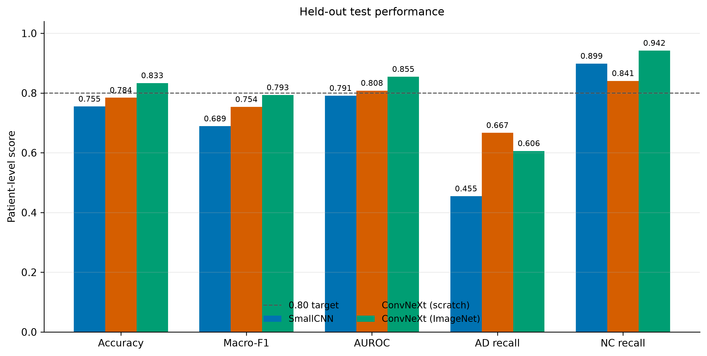
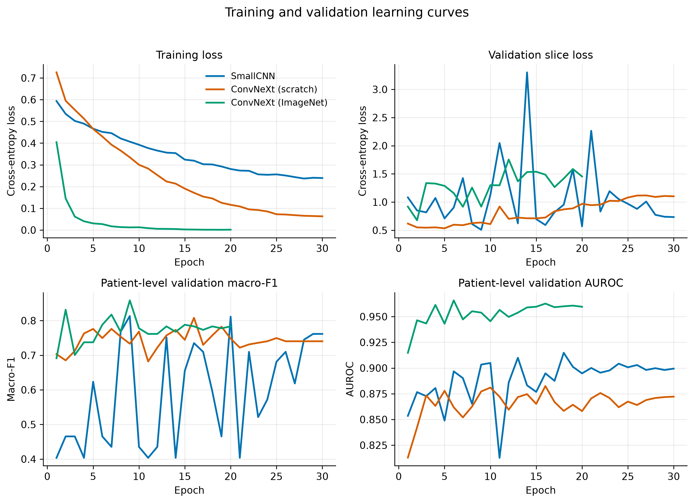
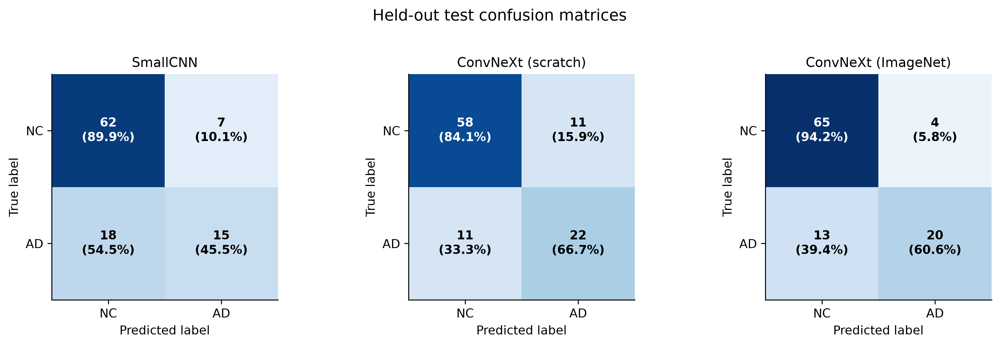
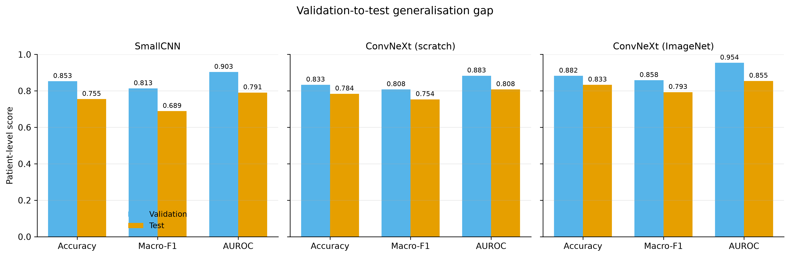
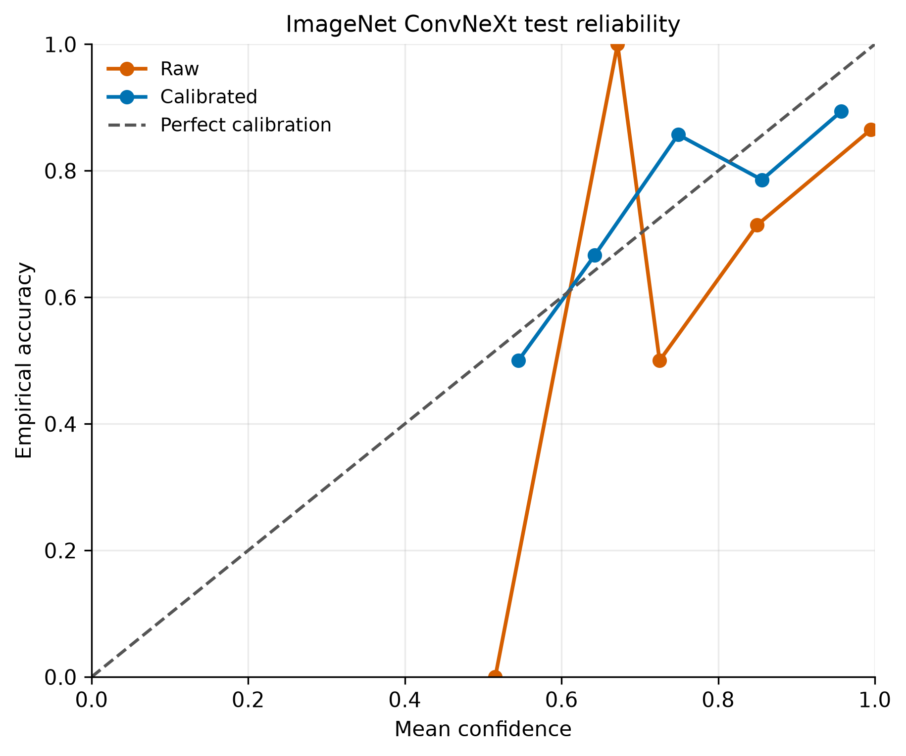
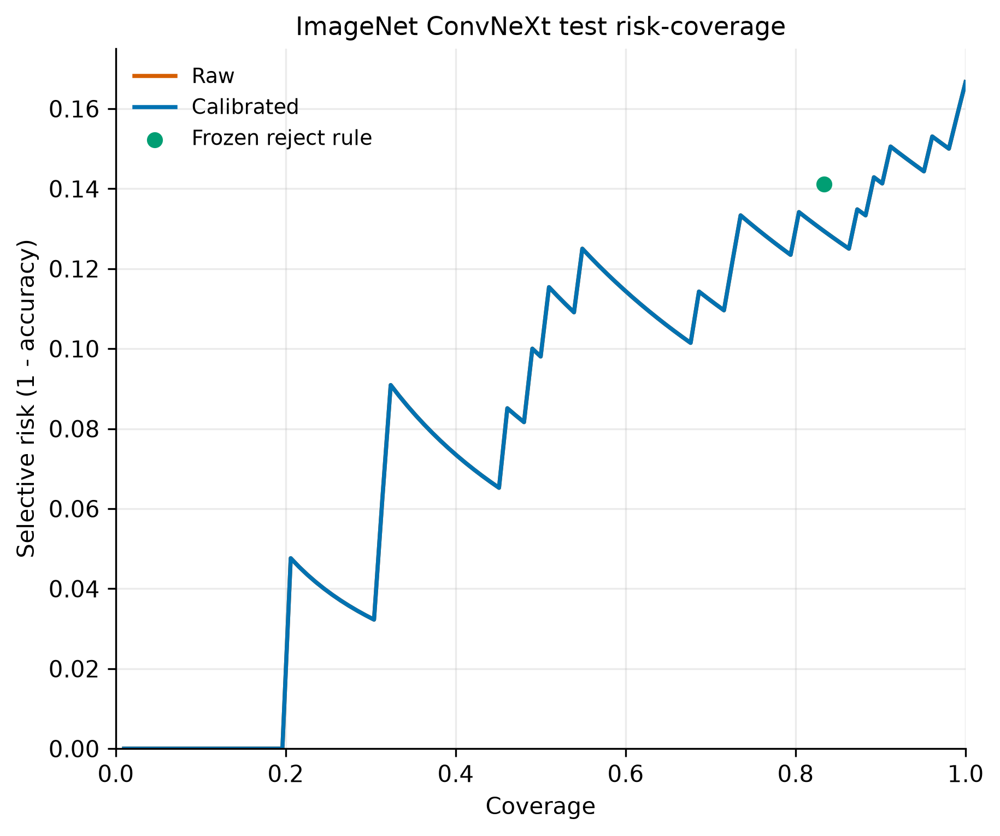
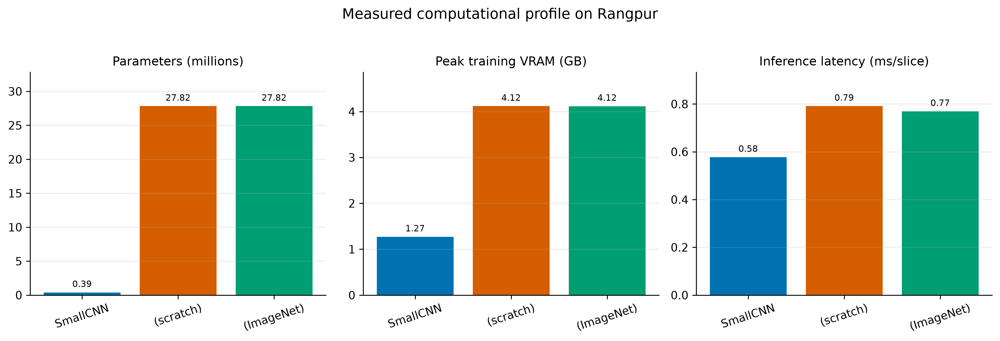

# Patient-Level Alzheimer’s Disease Classification from ADNI MRI with ConvNeXt

**Student:** s4985908  
**Course:** COMP3710 Pattern Recognition  
**Project:** ADNI AD-versus-CN classification — Hard difficulty

## Executive summary

This project develops a patient-level classifier for distinguishing Alzheimer’s disease (AD) from cognitively normal controls (CN) using preprocessed sagittal MRI slices from ADNI. The final system fine-tunes an ImageNet-initialised ConvNeXt-Tiny and averages the logits from every available slice and visit before making one decision per patient. A compact SmallCNN and a randomly initialised ConvNeXt-Tiny provide progressively stronger comparisons.

The final model correctly classified **85 of 102 held-out patients (83.33% accuracy)**, exceeding the project target of 80%. It also achieved **0.7931 macro-F1** and **0.8546 AUROC**. Temperature scaling reduced test expected calibration error (ECE) from 0.1436 to 0.0628. A validation-fitted reject option referred 17 uncertain test patients and achieved 85.88% accuracy on the remaining 85 patients. However, AD recall was only 60.61%, and several AD errors were made with high confidence. The engineering recommendation is therefore to retain the prototype for research and human-in-the-loop decision support, but **not** use it for autonomous clinical diagnosis.



## 1. Problem and research questions

ADNI provides multiple MRI scans per patient and 20 two-dimensional slices per scan. This creates two important engineering challenges:

1. slices and repeated visits from the same patient are correlated, so a slice-level random split would leak identity information;
2. a high aggregate accuracy can conceal overconfident or clinically costly errors.

The project therefore asks:

- Does ConvNeXt-Tiny improve patient-level performance over SmallCNN?
- Does ImageNet initialisation improve ConvNeXt optimisation and generalisation?
- Are patient probabilities calibrated?
- Can a validation-selected reject option route ambiguous patients to human review?
- Is the performance improvement justified by the additional compute cost?

In the source code, the normal class is named `NC`; it is equivalent to CN in this report.

## 2. Feasibility review

This is the written feasibility review presented during the compulsory tutor check-off. The tutor confirmed that the scope, patient-level split, model comparison, and proposed evaluation were appropriate.

### User need, scope, and acceptance criteria

The intended user is a research team investigating an MRI-based screening assistant. The prototype returns one AD/CN prediction and calibrated confidence per patient, with an optional referral decision. It is not intended to replace a clinician.

| Acceptance criterion | Target | Final outcome |
|---|---:|---:|
| Patient leakage | zero subject overlap | achieved |
| Held-out patient accuracy | at least 0.80 | **0.8333** |
| Evaluation | accuracy, class metrics, macro-F1, AUROC, calibration | achieved |
| GPU feasibility | peak training VRAM below 6 GB | **4.12 GB** |
| Ambiguity handling | validation-only calibration and referral thresholds | achieved |

### Model choice and course concepts

The project uses a hard-difficulty ConvNeXt-Tiny classifier. ConvNeXt modernises convolutional networks with a patchifying stem, depthwise convolutions, LayerNorm, inverted bottlenecks, GELU activations, residual connections, stochastic depth, and layer scale. These elements connect directly to course concepts including convolutional feature extraction, normalisation, regularisation, transfer learning, class imbalance, calibration, and rigorous held-out evaluation. SmallCNN provides a transparent baseline, while the scratch and ImageNet-initialised ConvNeXt runs separate architecture capacity from transfer-learning effects.

### Preliminary feasibility evidence

The data audit found 30,520 valid JPEG slices, 1,526 scans, and 680 patients, with exactly 20 slices per scan. It also found 216 patients shared between the supplied directory-level train and test sets. This made a new patient-level split necessary. CPU and GPU smoke tests confirmed valid `(N, 3, 224, 224)` batches, two-class logits, finite gradients, checkpoint saving, and full patient aggregation. ConvNeXt used approximately 4.12 GB peak training VRAM on an A100, within the resource budget.

### Risks, compute budget, and fallback

The main risks were patient leakage, class imbalance, overfitting of a 27.8M-parameter model, validation overfitting during calibration, and long GPU queue times. The planned budget was one A100 GPU, batch size 64, and at most 30 epochs per main experiment. The fallback was the 0.39M-parameter SmallCNN, which had already completed end-to-end training and inference. Additional safeguards included a deterministic split, patient-aware balanced sampling, validation-only checkpoint selection, explicit test locking, automated tests, and preservation of every experiment log.

## 3. Data audit and patient-level split

The course dataset is located at:

```text
/home/groups/comp3710/ADNI
```

JPEG filenames encode a scan identifier and slice index. `meta_data_with_label.json` maps each scan to a subject and diagnosis. Metadata label 2 is mapped to AD (model target 1), and label 0 is mapped to NC (model target 0).

The supplied directories had no repeated scan IDs, but **216 patients occurred in both directories**. Reusing that split would allow scans from one person to influence both training and evaluation. `scripts/audit_data.py` therefore pools the scans and calls `stratified_subject_split()` in `dataset.py`, which performs a deterministic, diagnosis-stratified 70/15/15 patient split using seed 3710. Every slice, scan, and visit from one subject remains in exactly one split.

| Split | Patients | AD | NC | Scans | Slices |
|---|---:|---:|---:|---:|---:|
| Train | 476 | 155 | 321 | 1,081 | 21,620 |
| Validation | 102 | 33 | 69 | 228 | 4,560 |
| Test | 102 | 33 | 69 | 217 | 4,340 |
| **Total** | **680** | **221** | **459** | **1,526** | **30,520** |

The resulting subject overlap is zero. Validation is used for checkpoint selection, temperature fitting, and reject-threshold selection. The test split was never used to choose checkpoints, temperatures, or thresholds; Section 7 records every time it was evaluated. Generated manifests contain machine-specific paths and are excluded from Git.

## 4. Preprocessing and patient aggregation

`dataset.py` validates the manifest and rejects any patient overlap. Each grayscale slice is resized to 224 × 224, copied into three channels, converted to a tensor, and normalised with ImageNet channel statistics. Training applies conservative random affine augmentation; validation and test transforms are deterministic.

Training is slice-based for computational efficiency. A patient-and-class-aware weighted sampler prevents the larger NC class and patients with many visits from dominating updates. During evaluation, the model processes all slices and all scans in the selected split. For patient `p`, logits are aggregated before softmax:

```text
patient_logit(p) = mean(logit(slice) for every slice from patient p)
patient_probability(p) = softmax(patient_logit(p))
```

All headline metrics are therefore patient-level. No patient’s 20 slices are divided between training, validation, and test.

## 5. Models

### 5.1 SmallCNN baseline

SmallCNN uses convolution–BatchNorm–ReLU blocks, max pooling, global average pooling, dropout, and a two-class linear head. It contains **389,410 trainable parameters** and supplies a low-cost reference for the complete pipeline.

### 5.2 ConvNeXt-Tiny from random initialisation

The custom ConvNeXt-Tiny in `modules.py` uses a 4 × 4 stride-4 stem, stage depths `[3, 3, 9, 3]`, channels `[96, 192, 384, 768]`, 7 × 7 depthwise convolutions, channels-last LayerNorm, 4× pointwise MLPs, GELU, layer scale, stochastic depth, and residual connections. Global average pooling and a two-class classifier produce NC/AD logits. It contains **27,821,666 trainable parameters**.

### 5.3 Final ImageNet-initialised ConvNeXt-Tiny

The final model is the same `ConvNeXtTiny` class from `modules.py` described in Section 5.2; only its starting weights differ. `load_imagenet_weights()` downloads torchvision’s `ConvNeXt_Tiny_Weights.IMAGENET1K_V1`, renames every tensor to this project’s layer names with `convert_torchvision_convnext_state_dict()`, discards the 1,000-class ImageNet head, and keeps a freshly initialised two-class head. Loading is strict: every one of the 180 backbone tensors must match, otherwise training stops. The whole network is then fine-tuned on ADNI, so the architecture and parameter count (27,821,666) are identical to the scratch model.

The first ImageNet run (job 650741) was trained with torchvision’s own ConvNeXt class. Because both implementations have identical layers, its frozen checkpoint was converted into `ConvNeXtTiny` and re-evaluated without retraining. Two unit tests check this: one confirms that every backbone tensor is mapped, and one confirms that a randomly weighted torchvision model and the converted `ConvNeXtTiny` give the same logits. `scripts/compare_predictions.py` confirmed that the re-evaluated validation and test predictions match the original run for every patient (see Section 7). All results reported for the final model therefore come from this project’s own ConvNeXt implementation.

ImageNet initialisation provides reusable low-level edge, texture, and shape filters, which makes optimisation more data-efficient than learning all 27.8M parameters from scratch. The pretrained weights are third-party material and are acknowledged in the references.

## 6. Training and model selection

All three models use the same patient split, transforms, balanced sampler, patient aggregation, seed 3710, AdamW optimiser, cosine learning-rate decay, weight decay `1e-4`, dropout `0.30`, batch size 64, and mixed precision on CUDA. The best checkpoint is selected by **validation macro-F1**, not test accuracy.

| Model | Initial LR | Epoch budget | Best epoch | Validation accuracy | Validation macro-F1 |
|---|---:|---:|---:|---:|---:|
| SmallCNN | 3e-4 | 30 | 9 | 0.8529 | 0.8133 |
| ConvNeXt-Tiny, scratch | 3e-4 | 30 | 16 | 0.8333 | 0.8081 |
| ConvNeXt-Tiny, ImageNet | 5e-5 | 20 | 9 | **0.8824** | **0.8583** |

The pretrained network uses a smaller learning rate and shorter schedule because large updates can destroy useful pretrained features. Consequently, the scratch-versus-pretrained result is a practical engineering comparison, not a perfectly controlled single-variable ablation. Fixed epoch budgets make experiments reproducible and cap cluster usage; checkpoint selection still prevents the final epoch from being chosen automatically.

`train.py` redraws `training_curves.png` after every epoch (training and validation loss, patient-level validation accuracy, macro-F1 and AUROC, and the learning rate), so progress can be inspected while a job is running. For the ImageNet model, training loss falls close to zero while validation loss rises from epoch 2, even though validation AUROC keeps improving. The network becomes increasingly overconfident rather than less discriminative, which anticipates the large calibration temperature in Section 8.

To estimate seed sensitivity, the scratch ConvNeXt was also trained with seeds 2026 and 4985908 on the same split. Their best validation macro-F1 values were 0.7760 and 0.7973, compared with 0.8081 for seed 3710, so differences of about 0.03 macro-F1 between runs are within ordinary seed variation. These two runs were evaluated on validation only.



## 7. Held-out test results

The following results include all 102 patient-disjoint test subjects. Smoke-test outputs are excluded.

**Test-set use.** The test split was evaluated in this order. (1) SmallCNN and scratch ConvNeXt were tested once each; both fell below the 0.80 target. (2) A SmallCNN + scratch-ConvNeXt logit ensemble, with weights and threshold fitted on validation, was tested once and reached 0.8039 accuracy (82/102), 0.7591 macro-F1, and 0.8019 AUROC. (3) Because the scratch model was still below target, an ImageNet-initialised ConvNeXt was trained, selected on validation only, and tested once. (4) To verify the implementation change in Section 5.3, the same frozen ImageNet checkpoint was re-run with `ConvNeXtTiny`; this run checked equivalence and did not select a model. No checkpoint, temperature, or threshold was chosen using test data. However, deciding to try another model after seeing the first test results is an indirect form of test-set reuse, so the final 83.33% should be read as mildly optimistic. With 102 test patients, its 95% Wilson confidence interval is 74.9–89.3%.

| Test metric | SmallCNN | ConvNeXt scratch | ConvNeXt ImageNet |
|---|---:|---:|---:|
| Accuracy | 0.7549 (77/102) | 0.7843 (80/102) | **0.8333 (85/102)** |
| Macro-F1 | 0.6888 | 0.7536 | **0.7931** |
| AUROC | 0.7910 | 0.8081 | **0.8546** |
| AD precision | 0.6818 | 0.6667 | **0.8333** |
| AD recall | 0.4545 | **0.6667** | 0.6061 |
| NC precision | 0.7750 | **0.8406** | 0.8333 |
| NC recall | 0.8986 | 0.8406 | **0.9420** |

ImageNet initialisation improved test accuracy by 4.90 percentage points over scratch ConvNeXt and by 7.84 points over SmallCNN. It also produced the strongest macro-F1 and AUROC. The scratch model retained the highest AD recall, illustrating that model selection depends on the operational cost assigned to false negatives rather than accuracy alone.



The final model’s confusion matrix is TN = 65, FP = 4, FN = 13, TP = 20. The validation–test gap indicates mild optimism from model selection: ImageNet ConvNeXt accuracy fell from 88.24% on validation to 83.33% on test, while macro-F1 fell from 0.8583 to 0.7931.



## 8. Calibration and reject-option investigation

A single temperature is fitted to validation logits only. The fitted value for the final model is 3.2259. Temperature scaling preserves the class ranking and accuracy but softens overconfident probabilities.

| Test probability metric | Raw | Temperature-scaled |
|---|---:|---:|
| Negative log-likelihood | 0.9973 | **0.4405** |
| Brier score | 0.1447 | **0.1314** |
| ECE | 0.1436 | **0.0628** |



The reject rule accepts NC when calibrated `P(AD) <= 0.1373`, accepts AD when `P(AD) >= 0.5`, and refers intermediate probabilities. Both thresholds were selected on validation with a minimum coverage of 0.50 and target accepted-case AD sensitivity and NC specificity of 0.90.

| Selective result | Validation | Test |
|---|---:|---:|
| Accepted patients | 88/102 | 85/102 |
| Referred patients | 14/102 | 17/102 |
| Coverage | 0.8627 | 0.8333 |
| Selective accuracy | 0.9432 | 0.8588 |
| Accepted-case AD sensitivity | 0.9231 | 0.7143 |
| Accepted-case NC specificity | 0.9516 | 0.9298 |

The reject option increased test accuracy among accepted patients from 83.33% to 85.88%, but its accepted-case AD sensitivity did not transfer from validation. It referred five of the 17 total test errors; 12 errors remained among accepted patients. Therefore, confidence-based referral is useful but insufficient as a safety mechanism.



## 9. Resource profile

Measurements were recorded on Rangpur A100 jobs. Training time is the summed train-plus-validation loop time in each saved history; inference latency covers full-split forward passes and excludes scheduler queue time.

| Model | Trainable parameters | Peak training VRAM | Training loop time | Test inference ms/slice |
|---|---:|---:|---:|---:|
| SmallCNN | 0.389M | **1.27 GB** | 15.80 min | **0.577** |
| ConvNeXt scratch | 27.822M | 4.12 GB | 17.63 min | 0.791 |
| ConvNeXt ImageNet | 27.822M | 4.12 GB | **11.35 min** | 0.769 |



SmallCNN is much smaller and slightly faster, but the final ConvNeXt still fits comfortably below the 6 GB feasibility limit. The pretrained run also reached its best checkpoint earlier and required only 20 epochs.

## 10. Qualitative failure autopsies

`failure_cases.py` ranked errors by calibrated confidence and created private nine-slice montages. The final model made 17 errors: 13 false negatives and 4 false positives. Four representative high-confidence failures were inspected. Subject identifiers and MRI montages are intentionally omitted from the public repository because they are course medical data.

| Case | Error | Calibrated P(AD) | Evidence across slices | Likely failure mode and engineering response |
|---|---|---:|---|---|
| A | AD → NC | 0.0286 | 4 scans / 80 slices; every raw slice predicted NC | A systematic patient-level miss, not one corrupt slice. Add 3D or longitudinal context and examine acquisition/domain variation. |
| B | NC → AD | 0.7775 | 3 scans / 60 slices; 48 slices predicted AD | Persistent but visit-dependent false evidence. Replace equal averaging with learned attention and test scan-level consistency. |
| C | AD → NC | 0.0343 | 1 scan / 20 slices; every slice predicted NC | High-confidence representation failure. Investigate medical-domain pretraining and saliency before trusting probability magnitude. |
| D | AD → NC | 0.0489 | 1 scan / 20 slices; every slice predicted NC | Another coherent false negative, suggesting label/disease heterogeneity or inadequate 2D context rather than random noise. |

All four cases were accepted rather than referred. This demonstrates the central dilemma: calibration can improve average probability quality but cannot guarantee that every high-confidence decision is correct. These are image-based engineering hypotheses, not anatomical diagnoses.

## 11. Recommendation to the project manager

The prototype meets the numerical accuracy and resource targets and supports reproducible patient-level experimentation. ImageNet fine-tuning is the preferred model because it gives the strongest accuracy, macro-F1, AUROC, calibration, and validation convergence while remaining within the GPU budget.

The system should nevertheless remain a **research prototype or clinician-facing decision-support tool**. Its 13 AD false negatives, 60.61% AD recall, and high-confidence misses are unacceptable for autonomous screening. The next experiment should prioritise sensitivity and robustness rather than further optimising test accuracy: evaluate 3D or multi-slice attention, use a cost-sensitive patient-level objective, add external-site validation, and assess subgroup/scanner performance. Any referral interface should display model uncertainty and scan consistency, while leaving the final decision to a qualified reviewer.

## 12. Usage and reproducibility

### Environment

The tested Rangpur environment is Python 3.11.15, PyTorch 2.13.0, torchvision 0.28.0, Pillow 12.3.0, NumPy 2.4.6, and matplotlib 3.11.2. Exact versions are pinned in `requirements.txt`.

```bash
cd "$HOME/PatternAnalysis-2026"
$HOME/miniconda3/bin/conda run -n torch \
  python -m pip install -r recognition/ConvNeXt_ADNI_s4985908/requirements.txt
```

### Audit, tests, and training

```bash
python recognition/ConvNeXt_ADNI_s4985908/scripts/audit_data.py
sbatch recognition/ConvNeXt_ADNI_s4985908/scripts/run_tests.slurm
sbatch recognition/ConvNeXt_ADNI_s4985908/scripts/train_smallcnn.slurm
sbatch recognition/ConvNeXt_ADNI_s4985908/scripts/train_convnext.slurm
sbatch recognition/ConvNeXt_ADNI_s4985908/scripts/train_convnext_imagenet.slurm
```

The latest automated run passed all **fourteen tests**. They cover the split function on a synthetic cohort (sizes, determinism, invalid ratios), patient-disjoint splits on the real manifest, label consistency, 20 slices per scan, data shapes, all three model constructors and forward passes, exact equivalence between torchvision ImageNet weights and the converted `ConvNeXtTiny`, and invalid-input rejection.

Training curves can also be redrawn from any saved run without retraining:

```bash
python recognition/ConvNeXt_ADNI_s4985908/train.py \
  --plot-history <OUTPUT_DIR>/history.json
```

### Example inference

```bash
python recognition/ConvNeXt_ADNI_s4985908/predict.py \
  --checkpoint <OUTPUT_DIR>/best.pt \
  --split validation \
  --output-dir <PREDICTION_DIR> \
  --batch-size 64 \
  --num-workers 4 \
  --device cuda \
  --plots
```

The output includes a row per slice, a row per patient, and a JSON summary. With `--plots`, the script also saves `<split>_patient_predictions.png`, a non-identifying figure of every patient’s P(AD) by true class next to the confusion matrix. It then prints the patient accuracy and a few example rows:

```text
patient_accuracy=85/102 (0.8333)
example patients (target -> predicted, P(AD), scans, slices):
  patient 1: NC -> NC, P(AD)=0.015, scans=3, slices=60
  patient 4: AD -> AD, P(AD)=1.000, scans=5, slices=100
``` A typical patient row contains the subject key, target class, aggregated NC/AD logits, AD probability, predicted class, number of scans, and number of slices. Test inference requires `--allow-test` and rejects partial test runs.

### Calibration and final test evaluation

```bash
MPLCONFIGDIR=$HOME/tmp/matplotlib \
python recognition/ConvNeXt_ADNI_s4985908/evaluate.py \
  --validation-csv <VALIDATION_DIR>/validation_patient_predictions.csv \
  --test-csv <TEST_DIR>/test_patient_predictions.csv \
  --output-dir <FINAL_RESULTS_DIR> \
  --expected-validation-patients 102 \
  --expected-test-patients 102 \
  --plots \
  --allow-test
```

Slurm scripts record job ID, host, Git commit, timestamps, GPU details, and output directory. Seed 3710 is used for the split and reported primary experiments. Raw data, manifests with machine paths, checkpoints, logs, patient prediction files, and private MRI montages are excluded from Git.

## 13. Repository structure

```text
ConvNeXt_ADNI_s4985908/
|-- README.md
|-- dataset.py
|-- modules.py
|-- train.py
|-- predict.py
|-- evaluate.py
|-- ensemble.py
|-- convnext_ensemble.py
|-- failure_cases.py
|-- report_figures.py
|-- requirements.txt
|-- scripts/
|   |-- audit_data.py
|   |-- compare_predictions.py
|   |-- run_tests.slurm
|   |-- train_smallcnn.slurm
|   |-- train_convnext.slurm
|   `-- train_convnext_imagenet.slurm
|-- tests/
|   |-- test_patient_split.py
|   |-- test_dataset_shapes.py
|   `-- test_model_forward.py
|-- figures/report/         # aggregate, non-identifying report figures
|-- artifacts/              # generated locally; Git-ignored
|-- logs/                   # generated locally; Git-ignored
`-- outputs/                # checkpoints and patient results; Git-ignored
```

The ensemble scripts are retained as documented secondary experiments. The final reported system is the single ImageNet-initialised ConvNeXt-Tiny because it achieved 83.33% test accuracy without requiring multiple models at inference.

## 14. Limitations and ethics

ADNI is a research cohort and may not represent clinical prevalence, scanner variation, demographics, comorbidities, or external institutions. The 2D model discards volumetric context; repeated scans are correlated within a patient; dataset diagnosis labels are not pathology ground truth; and one 102-patient test split gives wide statistical uncertainty. ImageNet features originate from natural images rather than medical volumes. Validation selection can also overfit a small cohort, as shown by the validation–test gap and the weaker transfer of accepted-case AD sensitivity. No conclusion in this report establishes clinical validity.

## 15. References and attribution

1. Z. Liu et al., “A ConvNet for the 2020s,” *CVPR*, 2022. <https://openaccess.thecvf.com/content/CVPR2022/html/Liu_A_ConvNet_for_the_2020s_CVPR_2022_paper.html>
2. PyTorch Contributors, “ConvNeXt model and pretrained weights,” torchvision documentation. <https://docs.pytorch.org/vision/main/models/convnext.html>
3. C. Guo et al., “On Calibration of Modern Neural Networks,” *ICML*, 2017. <https://proceedings.mlr.press/v70/guo17a.html>
4. I. Loshchilov and F. Hutter, “Decoupled Weight Decay Regularization,” *ICLR*, 2019. <https://openreview.net/forum?id=Bkg6RiCqY7>
5. Alzheimer’s Disease Neuroimaging Initiative, ADNI data resource. <https://adni.loni.usc.edu/>

The final model’s starting weights are torchvision’s `ConvNeXt_Tiny_Weights.IMAGENET1K_V1`; they are third-party pretrained material rather than student-created weights. The parameter-name mapping in `convert_torchvision_convnext_state_dict()` was written by consulting the layer layout of torchvision’s ConvNeXt source (`torchvision/models/convnext.py`, reference 2); no torchvision model code is used at inference. The student-authored contribution is the ADNI data audit and patient split, model integration, custom training and evaluation loops, experiments, calibration/reject analysis, failure analysis, and report.

## Artificial Intelligence Usage Disclosure

I used AI tools as a supporting resource during this assignment. AI was used to help translate and understand the assignment requirements, plan the overall approach, and clarify how different parts of the task could be completed.

For the coding component, I used AI to assist with debugging, suggest possible improvements to my code, explain relevant concepts, and provide ideas on how I could improve the model's accuracy. I reviewed and understood the suggestions before making changes to my own work.

For the report, I used AI only to check grammar, identify incorrect or inappropriate wording, and improve unclear sentences. The main ideas, analysis, implementation, results, and final decisions in the assignment were completed by me.
